# Commodore 64 Wireless Joystick

A DIY wireless joystick system for the Commodore 64, using nRF24L01+ wireless modules and ATtiny/ATmega microcontrollers. The system consists of two main components:

* **Receiver (RX):** An ATtiny-based receiver that interfaces with the Commodore 64 dual joystick ports.
* **Transmitter (TX):** An ATmega-based wireless joystick controller.

## 1. Disclaimer

This project is provided **as-is**, without any guarantees of functionality or reliability etc. I built it in 2019 from various microcontrollers I was using at that time. It is not actively developed or maintained and uses hardware components and software libraries that are likely outdated. I am sharing as it may be useful for others for learning purposes or as a starting point to update and modernise. The useful bit is the C64 receiver PCB and code. The joystick / transmitter was mainly built for MAME use and the C64 receiver only handles a subset of the buttons.

## 2. Hardware Design

The EAGLE design files are located in the [`eagle/`](eagle/) directory. To modify, you may need to install the library file (.lbr)

### 2.1 Transmitter (TX)

The transmitter uses an ATmega328p microcontroller to read joystick inputs and send the corresponding button and directional states wirelessly via an nRF24L01+ transceiver. An MCP23008 was added to handle the extra buttons for MAME. A TP4056 module was added to charge a Lipo battery which powers the joystick.

| PCB Layout | Top | Bottom |
| --- | --- | --- |
| 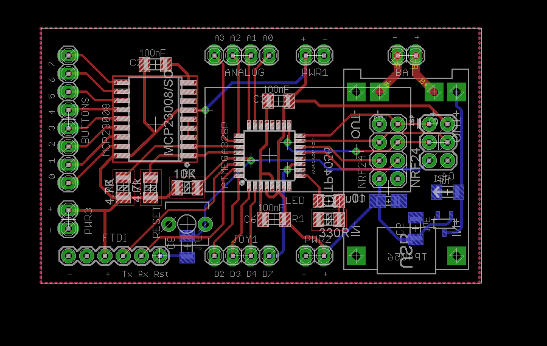 | 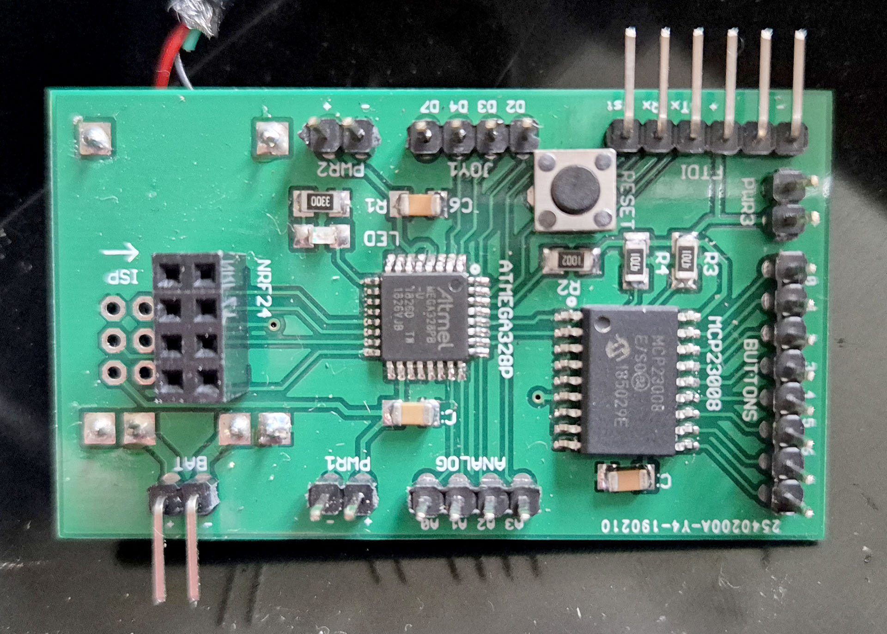 | 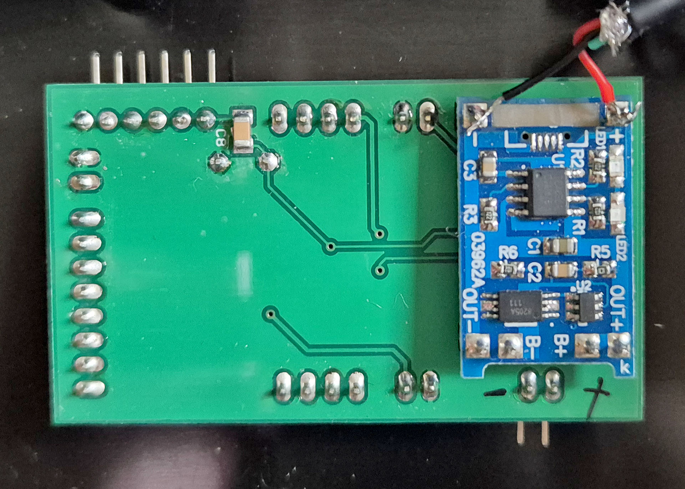 |

### 2.2 Receiver (RX)

The receiver uses an ATtiny 1634 microcontroller and an nRF24L01+ transceiver to receive joystick data and translate it into signals compatible with the Commodore 64 joystick port. For more information on the pin mapping see [control port mapping](docs/C64ControlPort.md)

| PCB Layout | Overview | Top | Bottom |
| --- | --- | --- | --- |
| 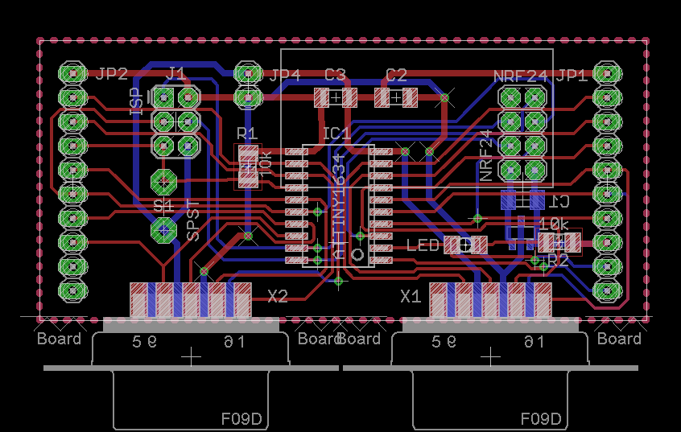 | 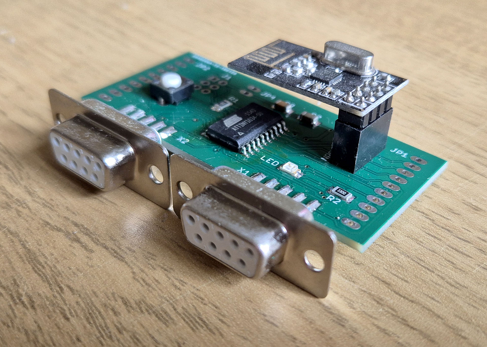 | 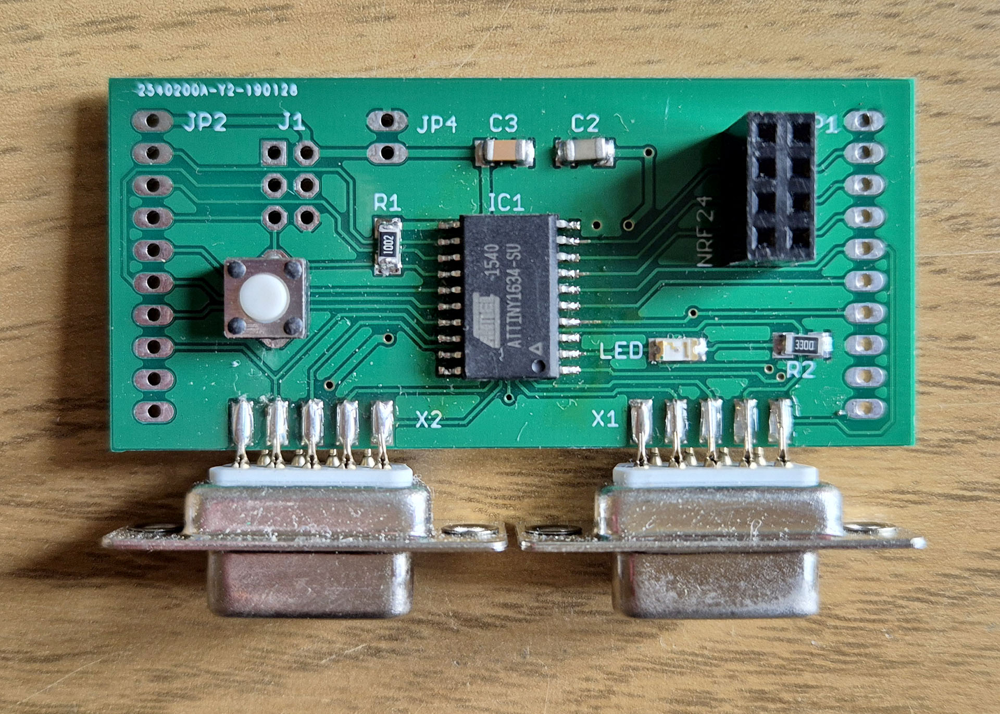 | 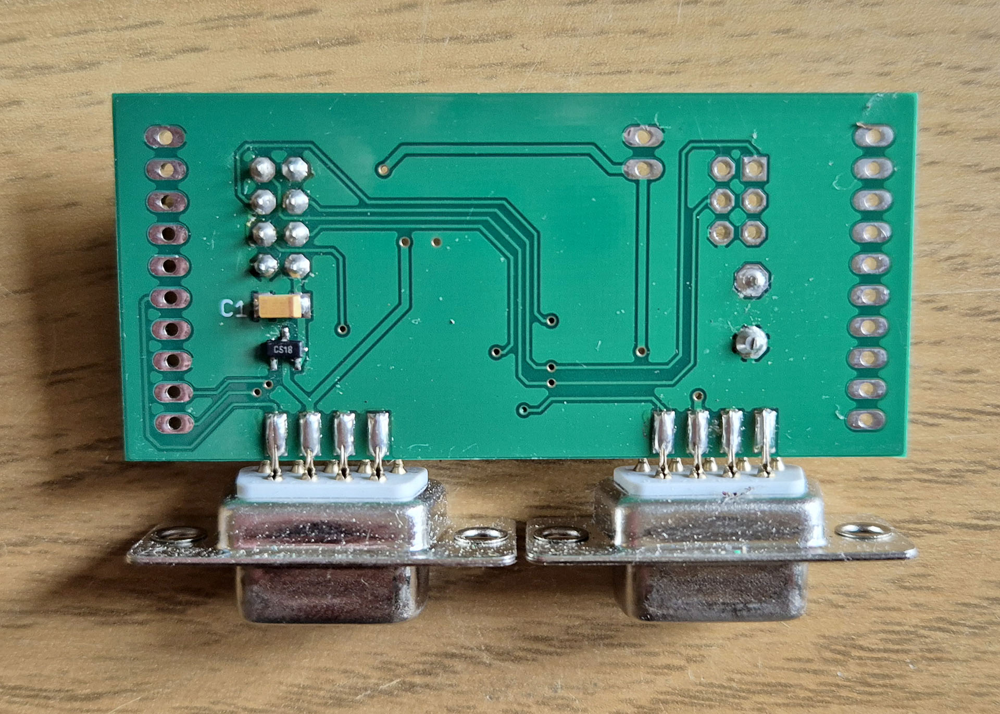 |

### 2.3 Bill of Materials (BOM)

Here is a list of the main components. Refer to the EAGLE schematics for exact component, values, quantities, and specifications etc.

#### Receiver
```
1 x ATTiny 1634
1 x nRF24L01+
1 x MCP1700 3.3V
2 x 9-pin D-SUB Female (PCB board mount variety)
```
#### Transmitter
```
1 x ATMega 328p QFP32
1 x nRF24L01+
1 x TP4056 (for LIPO battery and USB charging)
1 x Joystick, various buttons and a couple of pots
1 x MCP1700 3.3V
```
## 3. Firmware and Code

The firmware is located in the [`code/`](code/) directory. The code is divided into two main parts:

* **TX firmware:** Runs on the ATmega, reads the joystick inputs, and transmits their states over the nRF24 wireless link.
* **RX firmware:** Runs on the ATtiny, receives the wireless data, and translates it into the appropriate signals for the Commodore 64 joystick interface.

Notes on the [packet format](docs/PacketFormat.md):
* Analog axes are not implemented in the RX code
* Buttons 1-8 (except 5) register a button press on the C64 receiver
* Button 5 is used to toggle joystick 1 and 2 on the C64 receiver

### 3.1 Source Code

```text
code/
├── c64-wireless-joystick-tx/
│   └── c64-wireless-joystick-tx.ino
└── c64-wireless-joystick-rx/
    └── c64-wireless-joystick-rx.ino
```

### 3.2 Building and Uploading

The Arduino 1.8.8 IDE was use to compile the code.

### 3.3 Libraries and Dependencies

The firmware depends on the following external libraries: -

* https://github.com/nRF24/RF24
* https://github.com/spencekonde/attinycore
* https://github.com/adafruit/adafruit-mcp23008-library

*Note: This project uses the versions available in 2019/20. Current versions may not work!*

## 4. Hardware Build

Here are some pictures of the final build

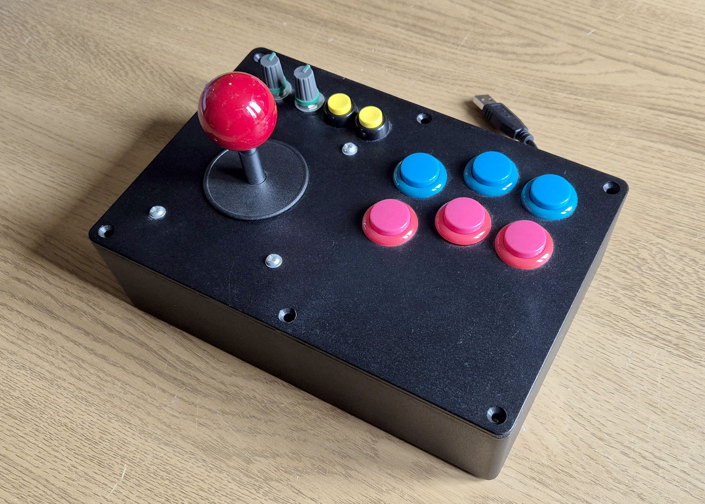
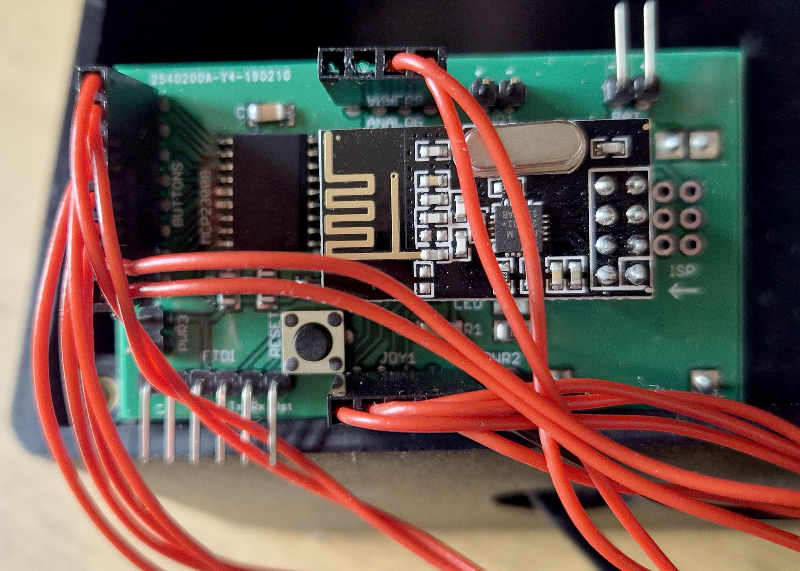
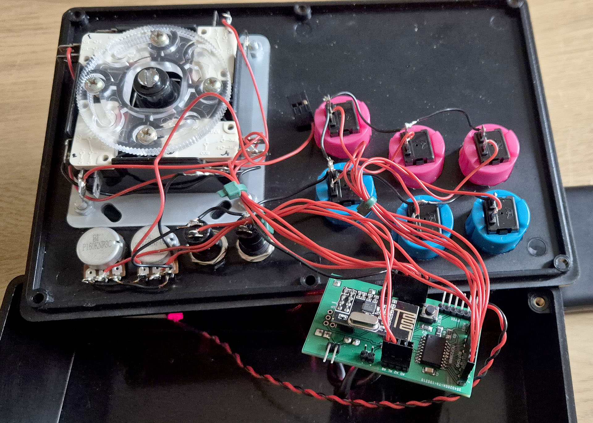 
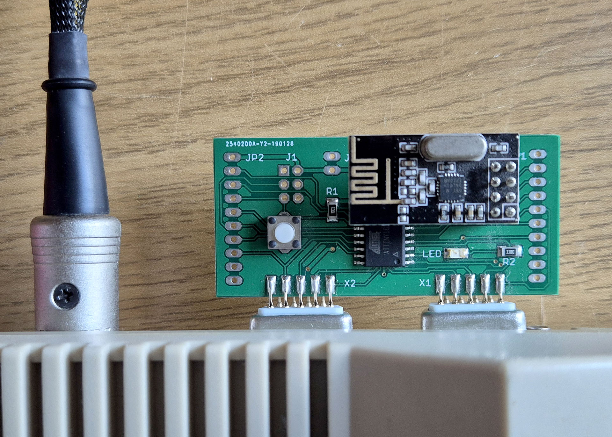 

